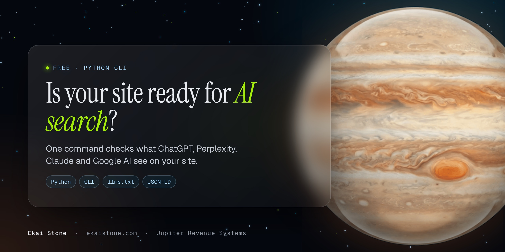

<p align="center"></p>

# ai-search-readiness-audit

One command that tells you whether AI search can find, read and cite your website: Google AI Overviews and AI Mode, ChatGPT search, Perplexity, Claude, Gemini and Copilot.

It checks robots.txt rules for 11 search and AI crawlers, your sitemap, llms.txt, indexing signals, meta tags, structured data, HTTPS and speed. Every check gets PASS, WARN or FAIL with a one-line fix, and the site gets a score out of 100.

- Python 3.9+, standard library only. No dependencies.
- Read-only. It only sends GET requests, with a User-Agent that names the tool and this repo.
- Works on any site. Timeouts and bad responses turn into FAIL lines, not crashes.

```bash
python3 audit.py https://yoursite.com
```

## What it checks and why it matters

| Check | PASS when | Why it matters for AI search |
|---|---|---|
| robots.txt | File exists and lists a sitemap | It's the first file every crawler reads. The Sitemap line tells them where your pages are. |
| Search engine crawlers | Googlebot and Bingbot aren't blocked | Google AI Overviews and AI Mode use Google's normal index. Copilot uses Bing's, and ChatGPT search also leans on Bing partner results. |
| AI answer engine crawlers | OAI-SearchBot, ChatGPT-User, Claude-SearchBot and PerplexityBot aren't blocked | These build the indexes ChatGPT, Claude and Perplexity cite from. Block them and you can't be a source. |
| AI training crawlers | GPTBot, ClaudeBot, Google-Extended, Applebot-Extended and CCBot aren't blocked | Blocking these doesn't remove you from AI search, but models learn less about your brand. It's a WARN, not a FAIL: it's your call. |
| XML sitemap | Found, valid XML, has URLs, listed in robots.txt | Crawlers find new and updated pages faster. Sitemap indexes and .gz files are supported. |
| llms.txt | `/llms.txt` exists and starts with a `# Name` line | Optional. A short Markdown summary of your site for language models. Few engines read it today, so it's a small weight. |
| Indexable | No `noindex` in meta robots or the `X-Robots-Tag` header, no `nosnippet` | A noindexed page can't show up or be cited anywhere. `nosnippet` stops Google from quoting it in AI Overviews. |
| Canonical URL | One self-referencing canonical | Tells engines which URL is the real one, so citations and signals don't split across duplicates. |
| Meta title | 30 to 60 characters | The title is the label engines and AI answers show next to your link. |
| Meta description | 70 to 160 characters | Engines use it as a summary of the page when they decide what it answers. |
| Single H1 | Exactly one H1 | A clear page topic helps engines match the page to a question. |
| Text in raw HTML | 150+ words readable without JavaScript | Most AI crawlers read the HTML and don't run JavaScript. If your content only appears after scripts run, they see a blank page. |
| Language attribute | `<html lang="...">` is set | Helps engines serve the page to the right language and region. |
| Open Graph tags | og:title, og:description and og:image | Controls how your links look when they're shared and previewed in chat apps and AI tools. |
| JSON-LD structured data | At least one valid JSON-LD block, no placeholders | Structured data states facts about you in a format machines don't have to guess at. |
| Organization or Person schema | Found on the start page | Tells engines who's behind the site, which is how they answer "who is" and "what is" questions about you. |
| WebSite schema | Found on the start page | Names the site and ties it to your organization. |
| sameAs profile links | 2+ profile URLs in sameAs | Connects your site to your LinkedIn, YouTube and other profiles, so engines know they're the same entity. |
| HTTPS | Served over HTTPS, and http:// redirects to it | A basic trust signal for search engines, browsers and the people who click through. |
| Server response time | Under 800 ms (WARN up to 1.8 s) | Slow servers get crawled less, and live fetches from ChatGPT or Perplexity can time out. |
| HTML page weight | Under 500 KB (WARN up to 2 MB) | Heavy HTML is slower to crawl, and some crawlers stop reading long files. |

The report also shows a table of all 11 crawlers and which of these schema types the start page has: Organization, Person, WebSite, Article, FAQPage, Product and BreadcrumbList.

## Install

With [pipx](https://pipx.pypa.io/) (adds an `ai-search-audit` command):

```bash
pipx install git+https://github.com/jupiter-revenue-systems/ai-search-readiness-audit
ai-search-audit https://yoursite.com
```

Or skip installing and run the file. It's one script with no dependencies:

```bash
git clone https://github.com/jupiter-revenue-systems/ai-search-readiness-audit
cd ai-search-readiness-audit
python3 audit.py https://yoursite.com
```

## Usage

```
ai-search-audit URL [--pages N] [--json | --markdown] [--timeout SEC] [--fail-under SCORE] [--no-color]
```

| Option | What it does |
|---|---|
| `--pages N` | Also audit N URLs sampled evenly from your sitemap (max 50). Page checks are averaged into the score. |
| `--json` | Print the full report as JSON. |
| `--markdown` | Print the report as Markdown, ready to paste into an issue or a doc. |
| `--timeout SEC` | Per-request timeout in seconds (default 15). |
| `--fail-under SCORE` | Exit with code 1 if the score is below SCORE. Handy in CI. |
| `--no-color` | Plain terminal output. `NO_COLOR` is respected too. |

Exit codes: `0` audit finished, `1` score below `--fail-under`, `2` bad URL or the audit couldn't run.

## Example output

Real runs, trimmed. A site that's mostly there, with 5 sampled pages:

```
$ python3 audit.py https://ekaistone.com --pages 5
AI Search Readiness Audit v1.0.0
URL      https://ekaistone.com/
Checked  2026-11-11 02:24:31 UTC, 6 pages

Score    87/100  Mostly ready

Crawl access
  PASS  robots.txt                     Found, 1 group, sitemap listed
  PASS  Search engine crawlers         All allowed: Googlebot, Bingbot
  PASS  AI answer engine crawlers      All allowed: OAI-SearchBot, ChatGPT-User, Claude-SearchBot, PerplexityBot
  PASS  AI training crawlers           All allowed: GPTBot, ClaudeBot, Google-Extended, Applebot-Extended, CCBot
  PASS  XML sitemap                    https://ekaistone.com/sitemap.xml: 39 URLs
  WARN  llms.txt                       Not found (HTTP 404); optional, few engines read it yet
        fix: Optional: add /llms.txt with a short site summary and links to your key pages.

Indexing
  PASS  Indexable (no noindex)         No noindex directive
  PASS  Canonical URL                  Self-referencing

Content
  PASS  Meta title                     54 chars
  PASS  Meta description               145 chars
  PASS  Single H1                      1 H1
  PASS  Text in raw HTML               2463 words without JavaScript
  PASS  Language attribute             lang="en"
  PASS  Open Graph tags                og:title, og:description, og:image

Structured data
  FAIL  JSON-LD structured data        No JSON-LD found
        fix: Add a JSON-LD block (Organization or Person, plus WebSite) so engines know who's behind the site.
  WARN  Organization or Person schema  No Organization or Person on the start page
        fix: Add Organization (or Person) JSON-LD with name, url, logo and sameAs.
  WARN  WebSite schema                 No WebSite schema
        fix: Add WebSite JSON-LD with the site name and URL to the home page.
  WARN  sameAs profile links           0 profile links
        fix: Add sameAs links to your official profiles (LinkedIn, YouTube, Crunchbase, etc.).

Security and speed
  PASS  HTTPS                          HTTPS, and http:// redirects to it
  PASS  Server response time           283 ms
  PASS  HTML page weight               289 KB (55 KB transferred)

...

Pages (start page + 5 from the sitemap)
   89  /
       FAIL JSON-LD structured data
   84  /seven-star
       WARN Meta title; FAIL JSON-LD structured data
   80  /refund-policy
       WARN Meta title; WARN Meta description; FAIL JSON-LD structured data
...
```

A bare placeholder page:

```
$ python3 audit.py https://example.com
AI Search Readiness Audit v1.0.0
URL      https://example.com/
Checked  2026-11-11 02:24:32 UTC, 1 page

Score    55/100  Needs work

Crawl access
  WARN  robots.txt                     Not found (HTTP 404); every crawler is allowed by default
        fix: Add a robots.txt that allows search and AI crawlers and lists your sitemap.
  PASS  Search engine crawlers         All allowed: Googlebot, Bingbot
  PASS  AI answer engine crawlers      All allowed: OAI-SearchBot, ChatGPT-User, Claude-SearchBot, PerplexityBot
  PASS  AI training crawlers           All allowed: GPTBot, ClaudeBot, Google-Extended, Applebot-Extended, CCBot
  FAIL  XML sitemap                    Not found or unreadable: https://example.com/sitemap.xml: HTTP 404
        fix: Publish /sitemap.xml with every indexable URL and list it in robots.txt.
...
Content
  WARN  Meta title                     14 chars (too short)
        fix: Rewrite the title to 30 to 60 characters: topic first, brand last.
  FAIL  Meta description               Missing meta description
        fix: Add a 70 to 160 character description that answers what the page is and who it's for.
  FAIL  Single H1                      No H1
        fix: Add one H1 that states the page topic in plain words.
  FAIL  Text in raw HTML               Only 25 words without JavaScript
        fix: Server-render the main content; most AI crawlers read the HTML and don't run JavaScript.
...

AI crawler access (robots.txt)
  Googlebot          search    allowed  Google Search, AI Overviews, AI Mode
  Bingbot            search    allowed  Bing, Copilot, ChatGPT partner results
  OAI-SearchBot      answer    allowed  ChatGPT search index
  ChatGPT-User       answer    allowed  ChatGPT live page fetches
  Claude-SearchBot   answer    allowed  Claude search index
  PerplexityBot      answer    allowed  Perplexity index
  GPTBot             training  allowed  OpenAI model training
  ClaudeBot          training  allowed  Anthropic model training
  Google-Extended    training  allowed  Gemini training and grounding
  Applebot-Extended  training  allowed  Apple Intelligence training
  CCBot              training  allowed  Common Crawl, used by many models

Schema types on the start page
  [ ] Organization  [ ] Person  [ ] WebSite  [ ] Article  [ ] FAQPage  [ ] Product  [ ] BreadcrumbList
```

## JSON output

`--json` prints everything: every check with its status, detail and fix, the crawler table, schema types, sitemap info and a block per page. Trimmed:

```json
{
  "tool": "ai-search-readiness-audit",
  "version": "1.0.0",
  "url": "https://example.com/",
  "final_url": "https://example.com/",
  "checked_at": "2026-11-11T02:24:33Z",
  "score": 55,
  "grade": "Needs work",
  "pages_audited": 1,
  "checks": [
    {
      "id": "crawlers_answer",
      "name": "AI answer engine crawlers",
      "category": "Crawl access",
      "weight": 10,
      "status": "PASS",
      "detail": "All allowed: OAI-SearchBot, ChatGPT-User, Claude-SearchBot, PerplexityBot",
      "fix": ""
    },
    {
      "id": "description",
      "name": "Meta description",
      "category": "Content",
      "weight": 5,
      "status": "FAIL",
      "detail": "Missing meta description",
      "fix": "Add a 70 to 160 character description that answers what the page is and who it's for."
    }
  ],
  "crawlers": [
    {
      "crawler": "Googlebot",
      "role": "search",
      "powers": "Google Search, AI Overviews, AI Mode",
      "status": "allowed",
      "group": "none"
    }
  ],
  "schema_types": {"Organization": false, "Person": false, "WebSite": false, "Article": false,
                   "FAQPage": false, "Product": false, "BreadcrumbList": false},
  "sitemap": {"url": null, "kind": null, "url_count": 0},
  "pages": [
    {
      "url": "https://example.com/",
      "http_status": 200,
      "score": 48,
      "title": "Example Domain",
      "word_count": 25,
      "response_time_ms": 164,
      "html_bytes": 577,
      "schema_types": [],
      "checks": ["..."]
    }
  ]
}
```

Crawler `status` is `allowed`, `partial` (allowed, with some paths disallowed), `blocked` or `unknown` (robots.txt didn't respond). `group` says which robots.txt group applied: `named`, `*` or `none`.

## How the score works

Each check has a weight. PASS counts in full, WARN counts half, FAIL counts zero. The heaviest checks are the ones that can take you out of AI search completely: noindex (12), search and AI answer crawlers (10 each), sitemap and HTTPS (8 each). Optional items like llms.txt and training crawlers weigh 2. With `--pages`, page-level checks are averaged across every page audited. 90+ is "Ready", 70 to 89 "Mostly ready", 50 to 69 "Needs work", under 50 "Not ready".

## Run the tests

```bash
python3 -m unittest discover -s tests -v
```

The tests run offline against small HTML, robots.txt and sitemap fixtures, plus a local server on 127.0.0.1.

## FAQ

**Will a perfect score get me cited by ChatGPT or Google?**
No tool can promise that. This checks the technical basics that stop engines from finding, reading or trusting your pages. Being cited also depends on your content and on people mentioning you around the web.

**Should I block AI training crawlers?**
That's your call. Blocking GPTBot, ClaudeBot, Google-Extended, Applebot-Extended or CCBot doesn't remove you from AI search results, but models learn less about you. Blocking the search crawlers (Googlebot, Bingbot, OAI-SearchBot, Claude-SearchBot, PerplexityBot) does remove you.

**Does it change anything on my site?**
No. It only sends GET requests, reads at most 5 MB per URL, and samples at most 50 pages. It never logs in or submits forms.

## Want it fixed for you?

The Seven Star Build turns your business into an AI-first company: https://ekaistone.com/seven-star/build?utm_source=github&utm_medium=readme

## License

MIT. See [LICENSE](LICENSE).

---

Built by Jupiter Revenue Systems, https://ekaistone.com. Star the repo if it helps.
